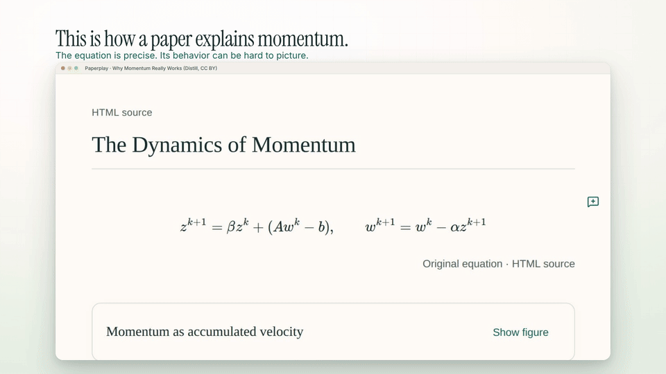
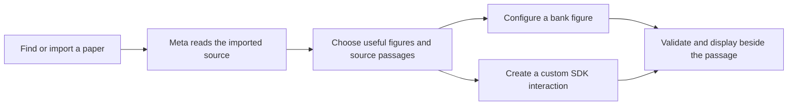

<p align="center">
  
</p>

<h1 align="center">Paperplay</h1>

<p align="center">
  <strong>Turn the hardest part of a research paper into something you can play with.</strong>
</p>

<p align="center">
  Interactive research papers · Powered by Meta AI · Built for the Meta AI Hackathon
</p>

<p align="center">
  <a href="#demo">Watch the demo</a> ·
  <a href="#quick-start">Run locally</a> ·
  <a href="#how-it-works">How it works</a> ·
  <a href="#documentation">Documentation</a>
</p>

## Demo

[](artifacts/paperplay-demo.mp4)

**[▶ Watch the full demo with sound — 1:42, 1080p](artifacts/paperplay-demo.mp4)**

Start with a momentum equation, explore how changing β reshapes its trajectory, then open **WASABI: Wasserstein Sampling via Bridge Interpolants** and watch Meta choose and build illustrations beside the paper.

The film combines recorded app footage, explanatory animation, and a synchronized replay of the same Meta-generated distribution model. [Recording details and music credits →](artifacts/README.md)

## Read the paper. Play with the idea.

An equation can be precise and still be hard to picture. What changes when a parameter moves? Why does a method behave differently? Where does the intuition behind the proof come from?

Paperplay keeps the original paper in view and adds interactive figures where they help. Open a paper, let Meta plan its illustrations, and explore the ideas alongside the passages that introduce them.

- **Find your next paper.** Search arXiv, browse research categories, preview abstracts, and save papers to your local library.
- **Get illustrations automatically.** Opening a paper starts Meta's editorial pass over the complete imported source. Meta chooses what to explain and where to place it.
- **Go beyond a fixed widget bank.** Meta can configure an existing figure or write a new interaction with the drawing and control SDK.
- **Explore the mechanism.** Move a slider, inspect a trajectory, step through a diagram, or compare numerical values without leaving the paper.
- **Keep the source close.** Original figures, mathematical notation, cited passages, notes, and focus reading stay in the same workspace.
- **Return to your work.** Reading progress and saved figures stay in your browser. Export compatible experiments and study material to carry them elsewhere.

## How it works



**Meta makes the editorial choices.** The planner receives all imported source blocks in reading order, with metadata, equations, figure captions, and extraction warnings. It selects complementary illustrations suited to the paper's length and complexity. Placement follows Meta's source anchors; keyword matching does not insert figures.

**The figure bank handles familiar interactions.** Ten figure kinds cover equations, functions, step diagrams, tables, linear transforms, probability, attention, graphs, signals, and custom declarative scenes. A bank figure is useful only when its actual controls and computation fit the chosen idea.

**New mechanisms can get new figures.** When the bank falls short, Meta can write an interaction against a restricted SDK. Generated code runs inside an isolated QuickJS interpreter with bounded resources. Compilation, source binding, layout checks, and interaction checks run before insertion; actionable failures can go back to Meta for repair.

**Saved work is reused.** Figures appear progressively, and accepted results are retained so returning to a paper can reopen its existing illustrations.

## Quick start

Use **Node.js 24.14+**; the pinned version is in [`.nvmrc`](.nvmrc).

```sh
git clone git@github.com:ManuelR-T/paperplay.git
cd paperplay
npm ci
cp .env.example .env.local
```

To enable automatic figure generation, edit `.env.local` and set your server-side Meta key:

```dotenv
MODEL_API_KEY=your_meta_api_key
META_MODEL=muse-spark-1.3
```

```sh
npm run dev
```

Open **[localhost:3000](http://localhost:3000)**. Go to **Explore** to find an arXiv paper, or import a supported PDF.

Prepared examples and saved local interactions remain available without an API key. New Meta generation requires a configured key. Keep it server-side; use `.env.local`, never a `NEXT_PUBLIC_` variable.

### Useful commands

| Command | Purpose |
| --- | --- |
| `npm run dev` | Start the local development server |
| `npm run check` | Run TypeScript, provider-free tests, and the production build |
| `npm run start` | Serve the production build |
| `npm run meta:check` | Check Meta configuration without inference |
| `npm run meta:check -- --live` | Make an explicit live provider probe |
| `npm run usage:summary` | Inspect recorded model usage |

The demo has its own [Remotion project](demo-video/README.md), including the edit, soundtrack, capture tools, and replay exporter.

## Built with

| Layer | Technology |
| --- | --- |
| App | Next.js App Router, React, TypeScript |
| Interface | Tailwind CSS, shadcn/ui, Lucide |
| AI | Official Meta API · `muse-spark-1.3` by default |
| Source import | arXiv HTML, PDF.js, Cheerio, KaTeX |
| Figure contracts | Zod schemas, source anchors, versioned manifests |
| Computation | Browser workers and an isolated QuickJS runtime for generated code |
| Persistence | IndexedDB for local reading data; SQLite for the default Node server's durable accounting |
| Demo | Remotion, FFmpeg, original procedural SFX |

## Source, privacy, and scientific scope

Papers, notes, and saved reading data are stored locally in the browser. Automatic preparation sends the **imported source text** to Meta, including equations, available figure captions, and image references. The planner does not receive the original image pixels, and this flow does not upload the local PDF binary to Meta.

Added figures are teaching models. Local checks establish that an interaction fits its contract and can run; they do not verify a paper's scientific claims or reproduce its experiments. Original research content keeps its authorship and attribution.

Structured arXiv HTML gives the richest import when available. Local PDFs must be text-based, at most **10 MiB and 50 pages**; imported sources have a **200,000-character** text limit. There is no OCR. Unsupported content retains its original-source reference.

Hackathon mode records usage with application request/token quotas **off by default**. Provider charges and limits still apply. See [Meta setup](docs/meta-setup.md), [operations](docs/operations.md), and [security](SECURITY.md) for configuration and trust boundaries.

## Documentation

| Topic | Guide |
| --- | --- |
| Automatic illustration workflow | [Automatic papers](docs/automatic-papers.md) |
| arXiv discovery | [Explore](docs/explore.md) |
| Original figures and source assets | [Original figures](docs/original-figures.md) |
| Generated interactions | [Generation architecture](docs/artifact-generation-design.md) · [Quality checks](docs/artifact-quality.md) |
| Scientific representation architecture | [Architecture](docs/scientific-architecture.md) |
| Add a computation engine | [Extension guide](docs/engine-extension.md) |
| Evaluation and evidence | [Acceptance matrix](docs/acceptance-matrix.md) · [Frozen evaluation](docs/frozen-evaluation-results.md) |
| Hosting | [Deployment](docs/deployment.md) · [Deferred Railway release plan](docs/railway-release.md) |
| Product roadmap | [Roadmap](docs/next-roadmap.md) · [GitHub issues](https://github.com/ManuelR-T/paperplay/issues) |

## License and credits

Project code is [ISC-licensed](LICENSE). Research sources retain their [own licenses and attribution](public/papers/ATTRIBUTION.md); dependency details are in [the notices](docs/dependency-notices.md).

Demo music: **“Cylinder Five” by Chris Zabriskie**, from *Cylinders*, under [CC BY 4.0](https://creativecommons.org/licenses/by/4.0/). [Source and audio credits](demo-video/public/audio/CREDITS.md).
