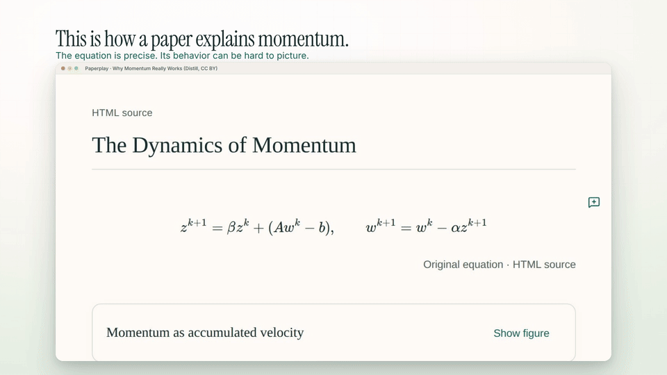

# Paperplay demo

**[▶ Watch the latest demo with sound — 1:42, 1920 × 1080](paperplay-demo.mp4)**

The latest export is **v19**, updated 4 November 2026. It includes the longer opening equation, the Show figure interaction, an explanatory momentum animation, recorded Meta generation on the WASABI paper, and the corrected distribution interaction. The full movie has English on-screen text, stereo music, and subtle sound effects.

The distribution interaction is a **synchronized replay** of the unchanged Meta-generated model. Its 401 exported states come from the application's isolated interpreter; the cursor, slider, chart, and table share the same state. This edit removes capture/computation delays and does not measure live application latency. The source-return shot and paper-generation take are recorded application footage.

- [Video metadata and SHA-256](paperplay-demo.json)
- [Remotion project and recording workflow](../demo-video/README.md)
- [Soundtrack attribution](../demo-video/public/audio/CREDITS.md)

## Music

“Cylinder Five” by Chris Zabriskie, from *Cylinders*.

Licensed under [Creative Commons Attribution 4.0](https://creativecommons.org/licenses/by/4.0/). [Original album and artist](https://chriszabriskie.com/cylinders/). The track is excerpted, mixed with original sound effects, and faded for the film. Credit is included in the outro; retain it when sharing.

## Earlier recordings

`paperplay-demo-raw.mp4`, `paperplay-demo.srt`, `demo-recording.json`, and the PNG captures document the earlier **27 October 2026** production demo. Its action timings and subtitle file do not apply to the current movie. That version showed graph playback, numerical optimization, experiment exports, and a saved Meta enrichment. The original edited export remains available in Git history.
